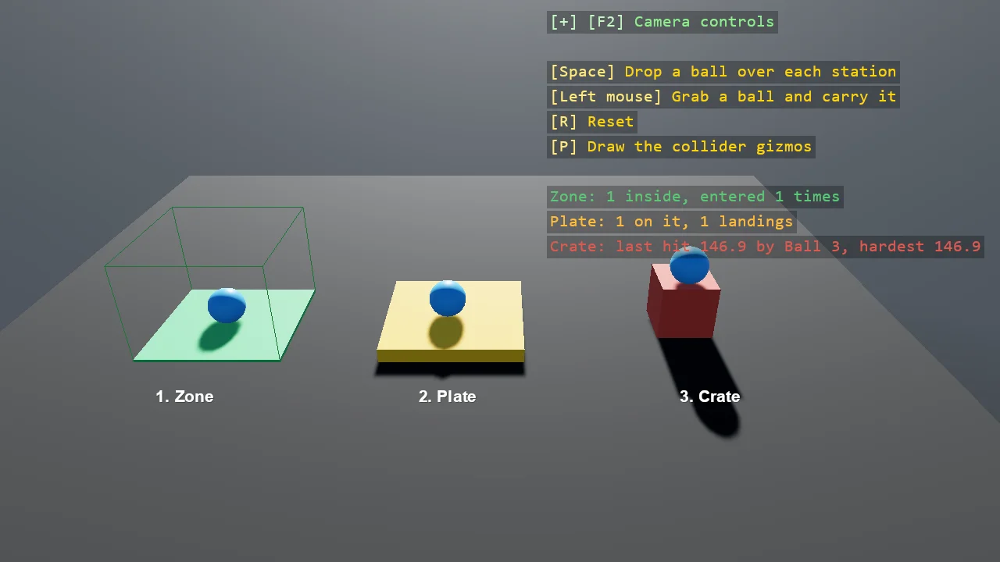

# Trigger Zones

Reacting to contact, three ways. A trigger zone is a static with no model whose handler says
NoContactResponse: bodies pass through it and OnEnter and OnLeave say who came and went. A plate is a
solid static with a handler of its own, counting what stands on it through OnStartedTouching and
OnStoppedTouching. A crate is a dynamic body whose handler measures each hit from the contacts of
the first touch. Space drops a ball over every station; the grabber carries bodies between them.

The `Program.cs` file shows how to:

- ContactEventHandler on a collidable, and NoContactResponse deciding whether it is solid
- Trigger with OnEnter and OnLeave on a static with no model, drawn as a debug box
- IContactHandler on a solid static, OnStartedTouching and OnStoppedTouching keeping a set of touchers
- IContactHandler on a dynamic body, the impact force of a first touch from its contacts
- Callbacks run on the main thread after the physics step, so they may change materials and entities
- Using helpers: SceneSetup3D, CreatePrimitive, AddGrabber, AddDebugShapes, AddPhysicsDebug, DebugOverlay

View on [GitHub](https://github.com/stride3d/stride-community-toolkit/tree/main/examples/code-only/E05_3D_TriggerZones).

[!code-csharp]