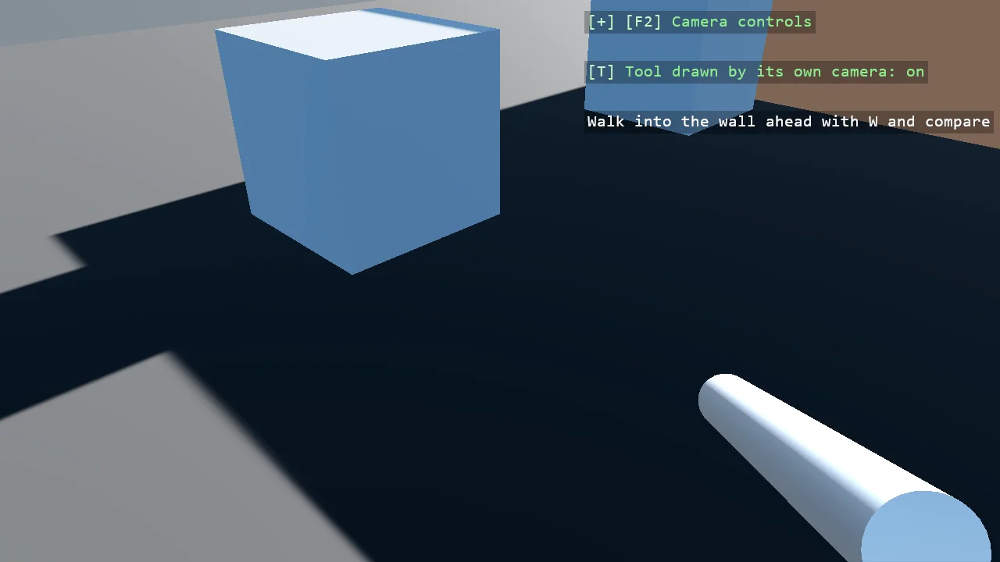

# View Model

The weapon that never clips: a tool held in front of a first-person camera is drawn by a camera
of its own over the finished view. The tool sits on a render group the main camera is told not
to draw, a second camera riding on the main one draws only that group into a texture with a
transparent background, and a screen-space rectangle lays the texture over the view after the
post effects. T switches the trick off, and the wall ahead cuts through the tool again.

The `Program.cs` file shows how to:

- A render group for the tool, and the main camera renderer's mask without it
- A render-texture camera as a child of the main camera, masked to the tool's group, clearing to transparent
- The feed laid over the view through a ShapeBatch after the post effects
- Finding the compositor's main camera renderer by its single view
- Using helpers: SceneSetup3D, UseBepu, UseSkybox, CreatePrimitive, CreateMaterial, AddRenderTextureCamera, FillWith, TextOverlay

View on [GitHub](https://github.com/stride3d/stride-community-toolkit/tree/main/examples/code-only/E09_3D_ViewModel).

[!code-csharp]