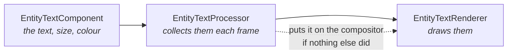

# Using toolkit components in Game Studio

**World Text**, **Entity Text** and **Shape** added to an entity in Game Studio draw in the
editor's viewport before you press Play. This page lists the components the toolkit adds to the
**Add component** menu, explains what makes the drawing ones work, what the `Add*` calls are for,
and what to check when a component does not draw.

## What you can add

Reference the package in the game project and the components appear in the entity's
**Add component** menu under the category shown. Their properties are edited in the property grid
like any engine component's.

| Package | Add component | Category | What it does |
|---|---|---|---|
| `Stride.CommunityToolkit` | Entity Text | Text | A screen-space label that follows the entity; see [Entity Text](rendering/entity-text.md) |
| | World Text | Text | Text in the scene at the entity's transform; see [World Text](rendering/world-text.md) |
| | Basic 2D Camera Controller | Camera | Pan and zoom for an orthographic camera; see [Camera Controllers](camera-extensions/camera-controllers.md) |
| | Basic 3D Camera Controller | Camera | Fly, look and move; see [Camera Controllers](camera-extensions/camera-controllers.md) |
| | Orbit Camera Controller | Camera | The camera circles a target; see [Camera Controllers](camera-extensions/camera-controllers.md) |
| | Game Profiler | Debug | Stride's profiler on screen, with its filter, sort and page as properties |
| | Sound Emitter (runtime instance) | Audio | Keeps a spatialised sound at the entity's position; see [Audio](audio-extensions/index.md) |
| `Stride.CommunityToolkit.Shapes` | Shape | Rendering | A flat shape at the entity's transform, drawn through a `ShapeBatch`; see [ShapeBatch](rendering/shape-batch.md) |
| | Reference grid | Debug | A numbered grid in world or screen coordinates; see [Reference Grid](rendering/reference-grid.md) |
| `Stride.CommunityToolkit.Bepu` | Body2DComponent | Physics - Bepu 2D | A dynamic body confined to the XY plane; see [Physics Extensions](physics-extensions/index.md) |
| | Collidable Gizmo (Bepu) | Physics | Shows or hides the collider gizmos of every collidable on a key |
| | Debug Render (Bepu) | Physics | Adds Bepu's debug render component once the scene is ready, with its toggle key |
| | Grabber (pick up bodies with the mouse) | Physics | Pick up, drag and throw bodies with the mouse |

`Stride.CommunityToolkit.Box2D` adds **Box2D Body** and **Grabber 2D** the same way, but it is not on
NuGet yet, so it is only available to a game that references the toolkit's source.

## A component is data; a processor sees to the rest

The toolkit's drawing components are built the way Stride's own are. The component holds *what* to
draw; a processor collects every component of its kind each frame; a renderer draws them:

Game Studio never runs a game's setup code, so the processor does the dashed step: the first time
it has something to draw, it puts its renderer on the scene's compositor, and checks again whenever
the editor swaps compositors (at start and on every change of view mode).

The processors also run in the editor, not only at runtime, which is what makes the viewport show
the result while you edit.

## What the manual calls are still for

`game.AddEntityTextRenderer()`, `game.AddWorldTextRenderer()` and `game.AddShapeBatch()` are not
required for a component to draw; they are how you take control:

| Call | What it gives you beyond the automatic path |
|---|---|
| `AddShapeBatch(depthTest)` | The batch handle, for drawing shapes from code every frame; the choice between a depth-tested batch and an overlay one; more than one batch in a scene. Components draw through the first batch registered this way and inherit its border, fill and glow state. |
| `AddWorldTextRenderer()` / `AddEntityTextRenderer()` | The renderer on the compositor before the first frame, and at the position in the renderer chain you choose. |

Without them a component gets a depth-tested shape batch, or a text renderer appended to the end
of the compositor's renderer chain, made on the first frame the component is drawn.

## Two things that look like failures but are not

**Nothing appears when you click the shape.** Clicking a shape in the viewport does not select it:
Stride's picking pass renders entity ids for models, and a shape is not a model. Select the entity
in the hierarchy instead; the transform gizmo then works as usual.

**Text needs no font.** Leaving `Font` empty is the supported path: the renderer falls back to
Stride's own `StrideDefaultFont`. Set one only when you want a *different* font, not to make text
appear at all.

## When it still does not draw

Each cause looks the same from the outside.

1. **Does the component appear in Add-component at all?** If a toolkit component is missing from the
   list entirely, the library was not registered for scanning. See
   [Making components work in Game Studio](../contributing/toolkit/game-studio-components.md).
2. **Is there anything to draw?** A `Shape` with no vertices, or a text with an empty `Text`, draws
   nothing by design. A `Shape` needs at least one vertex, and a single vertex needs a `Radius`.
3. **Is the entity where you think it is?** `WorldTextComponent` is positioned in the world and can
   sit behind the camera; `EntityTextComponent` in screen mode is placed in pixels; a `Shape` lies
   in its entity's XY plane unless `Billboard` is on, so a rotated entity can show it edge-on.
4. **Look at the Output pane.** The shape processor logs one line when it registers its own batch,
   and an effect that failed to compile is reported there, with the shader's name.

## Related

- [Entity Text](rendering/entity-text.md) - screen-space text anchored to an entity
- [World Text](rendering/world-text.md) - text living in the 3D scene
- [ShapeBatch](rendering/shape-batch.md) - the shapes, and `ShapeComponent`
- [Components and Scripts](components-and-scripts.md) - when to write a component, a processor or a script