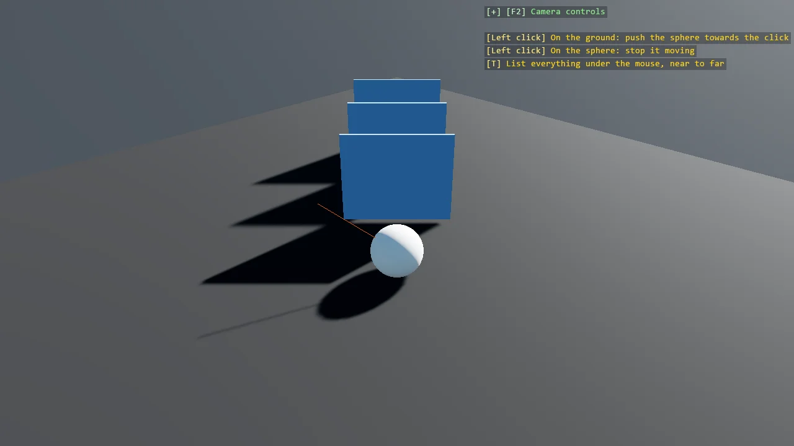

# Orientation Gizmo

`OrientationGizmoRenderer` draws the world axes in a corner of the screen, turning with the camera, the
way Game Studio's space marker shows which way is which in the scene editor. It is screen-space, drawn after the scene and over it,
and ignores depth, so it is never buried in the scene's content. It is in the
`Stride.CommunityToolkit.Rendering.Gizmos` namespace, with `AddOrientationGizmo`; `ScreenAnchor` in `Stride.CommunityToolkit.Rendering`.

```csharp
game.AddOrientationGizmo();
```

Call it from the Start callback, after the graphics compositor exists. The gizmo follows the first
camera of the compositor.



## What it draws

Each axis is an arrow from the centre, a shaft and a cone head in the editor's proportions, with its
letter in white just past the tip: red X, green Y, blue Z, the colours of the ground gizmo and of Game
Studio. The negative halves are small unlettered discs. Ends pointing away from the camera are drawn
first and dimmer, so the three arrows read as a tripod however the camera turns; an arrow pointing
straight at or away from the camera is seen end-on, a disc with its letter on it.

## Two gizmos

| | `AddGroundGizmo()` | `AddOrientationGizmo()` |
|---|---|---|
| Lives in | The world, at the ground's origin | A corner of the screen |
| Answers | Where the origin is, and how big a unit is | Which way the camera faces |
| Hidden by | Anything in front of it, or the camera looking away | Nothing: it ignores depth and stays in its corner |
| Letters | World text, optional | Always, past the arrow tips |

They are complementary, and the examples that use one usually use both.

## Placement and size

`AddOrientationGizmo` takes the corner or edge as a `ScreenAnchor` and returns the renderer, whose
properties cover the rest. Calling it again returns the same renderer and moves it.

```csharp
var gizmo = game.AddOrientationGizmo(ScreenAnchor.BottomRight);

gizmo.Size = 48;
gizmo.Opacity = 0.8f;
gizmo.ShowNegativeEnds = false;
```

| Property | Default | What it does |
|---|---|---|
| `Anchor` | `BottomLeft` | The corner or edge the gizmo sits in |
| `Size` | 40 | The length of an arrow, centre to tip, in pixels; the shaft, head and discs follow it in the editor's proportions |
| `Margin` | 12, 12 | The distance from the screen edge to the gizmo's reach |
| `FontSize` | 12 | The size of the axis letters |
| `Opacity` | 1 | The whole gizmo's opacity |
| `AutoScale` | `true` | The sizes above follow the display scale, so the gizmo is the same physical size on every monitor |
| `ShowLabels` | `true` | Letters past the arrow tips |
| `ShowNegativeEnds` | `true` | The negative halves, as smaller discs |
| `XColor`, `YColor`, `ZColor` | Red, green, blue | The axis colours |
| `LabelColor` | White | The letters, drawn over a faint shadow |

Sizes are in pixels before the display scale. The default bottom left corner is free in the examples:
the debug overlay sits top left, the camera help top right and the profiler top centre.

## Reading it

The gizmo is the camera's rotation, nothing else: moving the camera does not change it, turning it
does. With the default 3D camera, X points right and Z towards you, so a scene built along X and Z
reads as a plan when the camera looks down and as an elevation when it looks along Z. If a letter is
on a disc instead of an arrow, that axis points straight at or away from you.

## See also

- [Game Extensions](../game-extensions/index.md) for `AddGroundGizmo` and the other scene helpers.
- [Reference Grid](reference-grid.md) for numbered world or screen coordinates.
- [E07_3D_SimpleGeometry](../code-only/examples/simple-geometry.md), [E05_3D_Raycast](../code-only/examples/raycast.md) and [E05_3D_Constraints_Motors](../code-only/examples/constraint-motors.md) use it.