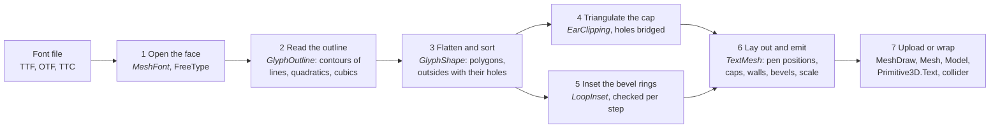
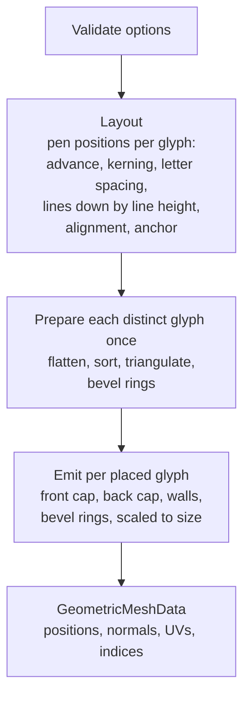
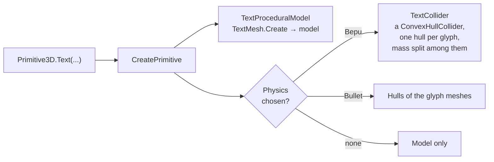

# How 3D text is built

[3D Text](text-3d.md) describes what `TextMesh` does; this page describes how. The pipeline turns a
string and a font into one `GeometricMeshData` in seven stages, each a small set of files with one
job. Everything up to the last stage works in the font's own EM units; the size the caller asked
for is applied as the vertices are written. File names without a folder are in
`src/Stride.CommunityToolkit/Rendering/Text/`; the others are given from `src/`.

## 1. The font

| File | Job |
|---|---|
| `MeshFont.cs` | Opens a face, caches the outline of every glyph it has read, hands out metrics and kerning, closes the face on dispose. `Default` is the embedded Open Sans; `Load` takes a path or bytes; `FromFamily` finds an installed font by family and style. |
| `FreeType.cs` | The toolkit's own binding to the FreeType library that `Stride.Graphics` ships: a handful of calls (init, open a face from memory, char index, load glyph, kerning, done face) and the structs they read. |
| `SystemFonts.cs` | Finds the file of an installed family and style on Windows, Linux and macOS, for `FromFamily`; shared with the overlay fonts. |
| `Fonts/` | Open Sans Regular and its licence, embedded in the assembly. |

Glyphs are loaded with the no-scale, no-hinting flags, so FreeType returns the outline as the font
designer drew it, in font units. `MeshFont` divides by the font's units per EM, and from here on
every coordinate is in EM units: a capital is about 0.7 tall, whatever the font. One lock per font
guards every face call and the disposal, so a font may be shared between threads.

## 2. The outline

| File | Job |
|---|---|
| `OutlineDecoder.cs` | Walks FreeType's points and tags, applying its rules for implied on-curve points between two quadratic controls, and emits segments. A contour of a single point, which some fonts carry, is skipped. |
| `OutlineSegment.cs`, `OutlineSegmentKind.cs` | One segment: a line, a quadratic or a cubic, with its control points. |
| `GlyphContour.cs` | One closed contour as segments, and `Flatten`, which turns it into a polygon. |
| `GlyphOutline.cs` | The glyph: its code point, advance, bounds and contours. `IsMissing` when the font has no glyph and gave its missing-glyph box instead. |

Flattening is by angle, not by count: a curve gets as many steps as its tangent turns, at
`CurveQuality` steps per full turn, so a tight bend gets many short edges and a gentle one few.
Cubics sample the tangent along the curve rather than at the ends, so an S-shaped cubic whose end
tangents are parallel is still subdivided. Duplicate and collinear points are cleaned off the
result.

## 3. The shape

| File | Job |
|---|---|
| `GlyphShape.cs` | Sorts the flattened contours into outsides and the holes inside them, by nesting depth: a contour inside no other is an outside, inside one is a hole, inside two is an outside again (the dot inside a copyright sign). |
| `GlyphPolygon.cs` | One outside with its holes, the outside wound counter-clockwise and the holes clockwise, which is what the triangulator takes. |
| `PolygonChecks.cs` | The segment tests the shape and the bevel share: does a loop cross itself, do two loops cross or run along each other, does an offset loop keep every edge pointing the way it did. |

Whether a contour lies inside another is decided by a vote of three of its points, so contours
that touch at a corner still sort. Two contours that cross each other are never nested: they are
kept as two filled pieces that overlap, which is how composite glyphs draw a cedilla through a C or
a bar through a Ⱥ. A contour that crosses itself is refused with the font and the code point in the
message.

## 4. The cap

| File | Job |
|---|---|
| `Stride.CommunityToolkit/Rendering/Utilities/EarClipping.cs` | Triangulates a simple polygon by ear clipping, and a polygon with holes by first joining each hole to the outside with a bridge and clipping the result as one ring. |
| `Stride.CommunityToolkit/Rendering/Utilities/PolygonBridging.cs` | Finds the bridge: from a hole's rightmost corner, the first edge of the outside that a ray to the right meets, then the visible corner of that edge (Eberly's method). |

`EarClipping` is public, in `Stride.CommunityToolkit.Rendering`; `PolygonBridging` is internal. The tolerances scale
with the polygon's extent, so a glyph triangulates the same way at any size, and an ear with any
area at all keeps its triangle: the walls keep every edge of the outline, so a cap that dropped a
sliver would leave a slit.

## 5. The bevel

| File | Job |
|---|---|
| `TextBevel.cs` | The request: size (how far in), thickness (how far down), segments. |
| `LoopInset.cs` | Moves a loop inward by a distance along the corner bisectors, with the miter capped; and `Fits`, which decides whether the moved loop is still the same loop, only smaller. |

A bevel is a quarter ellipse from the wall to the cap, built as rings: each ring is the previous
one inset a little further, and every step is checked against the one before (orientation kept, an
outside smaller and a hole larger, no edge turned round, no loop crossing itself or another). A
width that fails anywhere in the glyph is halved, up to six times, for the whole glyph, so the dot
and the stem of an i get the same bevel; a width that still fails fails the build, with the font and
the code point in the message. The normals follow the ellipse, so a shallow wide bevel
and a steep narrow one shade differently.

## 6. Layout and emission

| File | Job |
|---|---|
| `TextMesh.cs` | The entry points, and three private parts: `Layout` places the glyphs, `PreparedGlyph` holds a glyph's polygons, triangles and bevel rings, and `Emitter` writes vertices and indices. |
| `TextMeshOptions.cs` | Size, depth, bevel, curve quality, anchor, letter and line spacing, alignment, kerning. |
| `TextAnchor.cs` | The nine-point anchor on the block of text; `null` keeps the typographic origin at the first baseline. |
| `GlyphMesh.cs` | What `CreateGlyphs` returns: one mesh per glyph, centred on itself, with its place in the text. |

Caps use the triangulation from stage 4 at plus and minus half the depth; the front one reversed,
because Stride's front faces wind clockwise. Walls are four vertices per outline edge, flat shaded.
Texture coordinates run across the whole block of text on the caps and along each loop on the
walls, which is what the gradient and dissolve shaders of `E03_3D_TextShaders` read. A glyph that
appears twice in a string is prepared once per build.

## 7. Into the scene

| File | Job |
|---|---|
| `Stride.CommunityToolkit/Rendering/GeometricMeshDataExtensions.cs` | `ToMeshDraw` uploads the buffers, `ToMesh` adds the bounds, `Bounds` measures; shared with every other mesh built in code. |
| `Stride.CommunityToolkit/Rendering/ProceduralModels/TextProceduralModel.cs` | A procedural model whose mesh is `TextMesh.Create`; what `Primitive3D.Text` becomes. |
| `Stride.CommunityToolkit/Rendering/ProceduralModels/Primitive3D.cs` | `Primitive3D.Text(...)` and the `TextShape` record that carries the text, the font and the options to `CreatePrimitive`. |
| `Stride.CommunityToolkit.Bepu/Colliders/TextCollider.cs` | One convex hull per glyph for a body, from the same glyph meshes, with each position once; hulls are kept per font instance for the same text and options. |

The three ways in, from the most to the least done for you:

- `game.CreatePrimitive(Primitive3D.Text(...))`: a model, a material and, with a physics engine
  chosen, a collider.
- `TextMesh.CreateModel`, `CreateMesh` or `CreateMeshDraw`: GPU buffers you own and dispose; the
  frame counter in `E03_3D_MeshText` rebuilds one every frame this way.
- `TextMesh.Create` or `CreateGlyphs`: CPU data, for your own upload, your own colliders, or a body
  per letter as `E20_3D_CubeCollapse` does.

## What is cached where

| Cache | Lives | Holds |
|---|---|---|
| Glyph outlines | In the `MeshFont`, for its lifetime | Every glyph read from the face, by code point |
| Prepared glyphs | In one `TextMesh` call | Each distinct glyph's polygons, triangles and rings, so "oooo" prepares o once |
| Text hulls | With the `MeshFont`, per text and options, 64 strings | The collider hulls, so a word dropped a hundred times shares one set |

## Where the invariants are tested

`tests/Stride.CommunityToolkit.Tests/Rendering`: `MeshFontTests`, `OutlineDecoderTests`,
`GlyphShapeTests`, `EarClippingTests`, `TextMeshTests`, `TextBevelTests` and `TextReviewTests`.
Two helpers in `TextMeshTests` carry most of the weight: every mesh must be watertight (each
directed edge matched by its reverse, by exact position) and wound outward (no triangle against its
normals). The `text-3d` gold scene renders the whole alphabet, a bevelled sample and a
`Primitive3D.Text` and is compared pixel for pixel.