# TextureCanvas

@Stride.CommunityToolkit.Rendering.TextureCanvas builds and edits a texture at runtime: scaling,
image effects, and composing several textures into one.

```csharp
var renderContext = RenderContext.GetShared(game.Services);
using var canvas = new TextureCanvas(renderContext, new Size2(1024, 1024));
```

The third constructor parameter, `pixelFormat`, defaults to `PixelFormat.R8G8B8A8_UNorm`.

> [!NOTE]
> Dispose the canvas. It holds several GPU textures.

## Load a source texture

Most operations start from a texture loaded with the engine's API.

```csharp
var directory = Path.GetDirectoryName(Assembly.GetEntryAssembly()!.Location)!;
var filePath = Path.Combine(directory, "input.png");

using var input = File.Open(filePath, FileMode.Open);
var texture = Texture.Load(game.GraphicsDevice, input);
```

## Load into the canvas

`Load` reads a file, a `Stream` or a `byte[]` straight into the canvas.

```csharp
var directory = Path.GetDirectoryName(Assembly.GetEntryAssembly()!.Location)!;
var filePath = Path.Combine(directory, "input.png");
canvas.Load(filePath);
```

## Store

`Store` writes the canvas to a file or a `Stream`; `GetData` returns the bytes.

```csharp
var directory = Path.GetDirectoryName(Assembly.GetEntryAssembly()!.Location)!;
var filePath = Path.Combine(directory, "output.png");
using var output = File.Create(filePath);
canvas.Store(output, ImageFileType.Png);
```

`ToTexture` returns the result as a texture for a material or the UI.

```csharp
var output = canvas.ToTexture();
```

> [!NOTE]
> `Store` and `GetData` copy from the GPU to the CPU and stall the game. Do not call them every frame.

## Manipulation

### Resample

`Resample` changes the size or the pixel format and keeps the content, resized if necessary. Setting
`Size` or `PixelFormat` does the same for one of the two.

```csharp
canvas.Resample(size: new Size2(512, 512), pixelFormat: PixelFormat.R8G8B8A8_UNorm);
```

### BrightFilter

Applies a @Stride.Rendering.Images.BrightFilter. The values shown are the defaults.

```csharp
canvas.BrightFilter(threshold: 0.2f, steepness: 1.0f);
```

### GaussianBlur

Applies a @Stride.Rendering.Images.GaussianBlur. The values shown are the defaults.

```csharp
canvas.GaussianBlur(radius: 4, sigmaRatio: 2.0f);
```

### CoCMapBlur

Applies a @Stride.Rendering.Images.CoCMapBlur. The default radius is 4.

```csharp
canvas.CoCMapBlur(radius: 4);
```

### Transform

Applies a @Stride.Rendering.Images.ColorTransformGroup. `preTransforms` and `postTransforms` are
optional.

```csharp
canvas.Transform(transforms: new[] { new LuminanceToChannelTransform { ColorChannel = ColorChannel.R } });
```

### Combine

Applies a @Stride.Rendering.Images.ColorCombiner. A `null` entry in `textures` is the canvas content.

```csharp
canvas.Combine(
   textures: new [] { sourceTexture1, sourceTexture2, null /* = Canvas Content */ },
   factors: new [] { .2f, .2f, .6f }
);
```

### Colorize

Multiplies the canvas by a colour.

```csharp
canvas.Colorize(colorMultiplier: new Color4(1f, 0, 0));
```

### Recolorize

Multiplies the red channel by a colour. Without a colour the result is greyscale.

```csharp
canvas.Recolorize(colorMultiplier: new Color4(1f, 0, 0));
```

### Apply

Applies any @Stride.Rendering.Images.ImageEffect.

```csharp
using var effect = new GaussianBlur();
canvas.Apply(effect);
```

## Drawing

`DrawTexture` copies part of a source texture to part of the canvas, which composes several textures
into one.

### Stretch

How the source rectangle is resampled into the target rectangle.

- **None:**
The texture preserves its original size. Overflowing content is cropped.
- **Stretch:**
The texture is resized to fill the destination dimensions.
The aspect ratio is not preserved.
- **Contain:**
The texture is resized to fit in the destination dimensions while it preserves its native aspect ratio.
- **Cover:**
The texture is resized to fill the destination dimensions while it preserves its native aspect ratio.
If the aspect ratio of the destination rectangle differs from the source,
the source texture is clipped to fit in the destination dimensions.

### Anchor

How the source is aligned when clipping or padding is necessary. The effect depends on the stretch
mode.

- **TopLeft:**
  Adjust the position so the top-left corner of the source and target rect are aligned.
- **Top:**
  Adjust the position so the top-edge center of the source and target rect are aligned.
- **TopRight:**
  Adjust the position so the top-right corner of the source and target rect are aligned.
- **Left:**
  Adjust the position so the left-edge center of the source and target rect are aligned.
- **Center:**
  Adjust the position so the center of the source and target rect are aligned.
- **Right:**
  Adjust the position so the right-edge center of the source and target rect are aligned.
- **BottomLeft:**
  Adjust the position so the bottom-left corner of the source and target rect are aligned.
- **Bottom:**
  Adjust the position so the bottom-edge center of the source and target rect are aligned.
- **BottomRight:**
  Adjust the position so the bottom-right corner of the source and target rect are aligned.

### Draw

Every overload has this shape. The rectangles are `Rectangle` in pixels or `RectangleF` relative to
the texture and the canvas; omit the source rectangle for the whole texture and both for the whole
canvas.

```csharp
canvas.DrawTexture(
    texture,
    sourceRect,
    destinationRect,
    colorMultiplier: null,                     // Color4, multiplies the source
    stretch: Stretch.Stretch,
    anchor: Anchor.TopLeft,
    samplingPattern: SamplingPattern.Linear);
```

#### Examples
| Stretch | Anchor      | Source Rect           | Target Rect             | Result                       |
|---------|-------------|-----------------------|-------------------------|-----------------------------------|
| None    | TopLeft     | 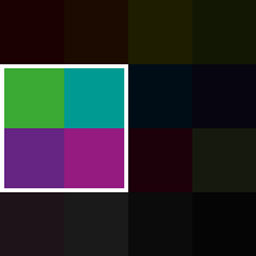 | 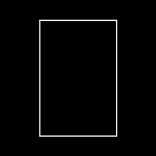 | 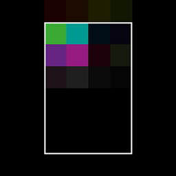      |
| None    | Top         |  |  | 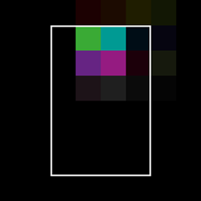    |
| None    | TopRight    |  |  | 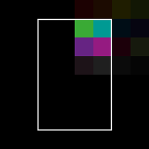     |
| None    | Left        |  |  | 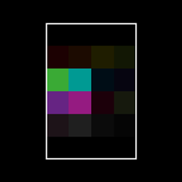   |
| None    | Center      |  |  | 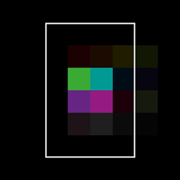 |
| None    | Right       |  |  | 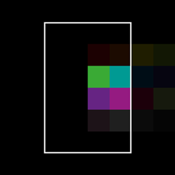  |
| None    | BottomLeft  |  |  | 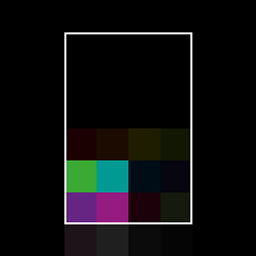   |
| None    | Bottom      |  |  | 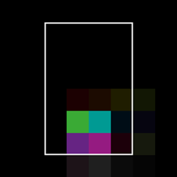 |
| None    | BottomRight |  |  | 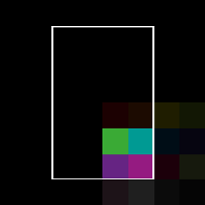  |
| Stretch | Any         |  |  | 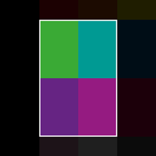      |
| Stretch | Any         |  | 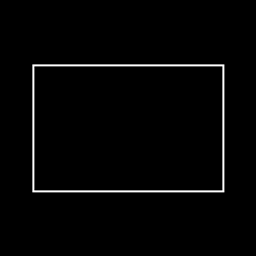 | 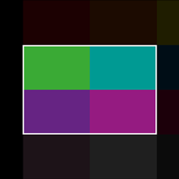      |
| Contain | AnyLeft     |  |  | 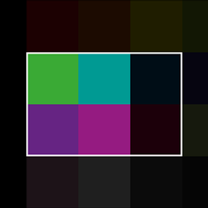       |
| Contain | AnyRight    |  |  | 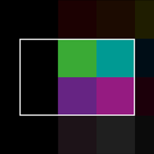      |
| Contain | AnyTop      |  |  | 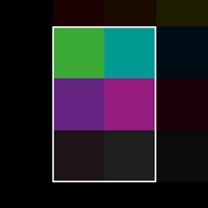        |
| Contain | AnyBottom   |  |  | 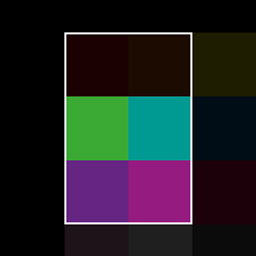     |
| Contain | AnyCenter   |  | 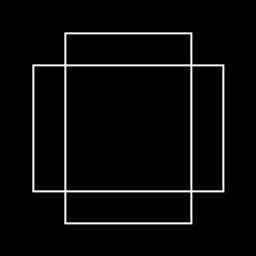   | 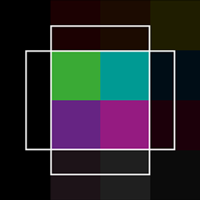     |
| Cover   | AnyLeft     |  |  | 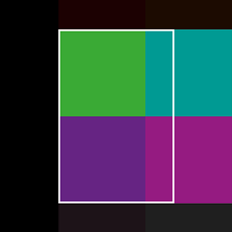         |
| Cover   | AnyRight    |  |  | 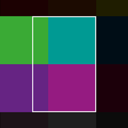        |
| Cover   | AnyTop      |  |  | 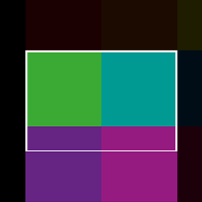          |
| Cover   | AnyBottom   |  |  | 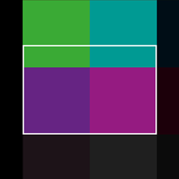       |
| Cover   | AnyCenter   |  |    | 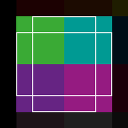       |

View on [GitHub](https://github.com/stride3d/stride-community-toolkit/tree/main/examples/code-only/E09_2D_ImageProcessing).

[!code-csharp[](../../../examples/code-only/E09_2D_ImageProcessing/Program.cs)]